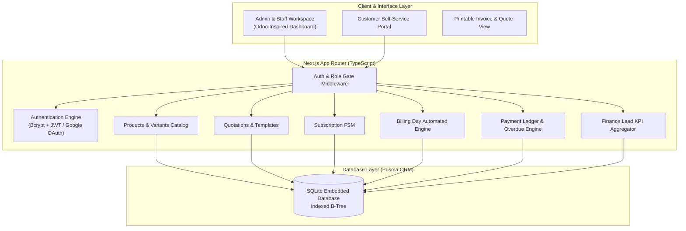
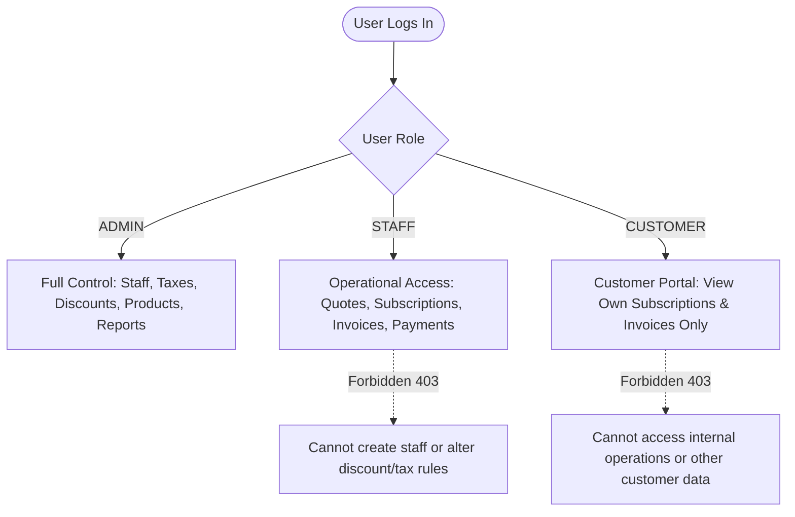
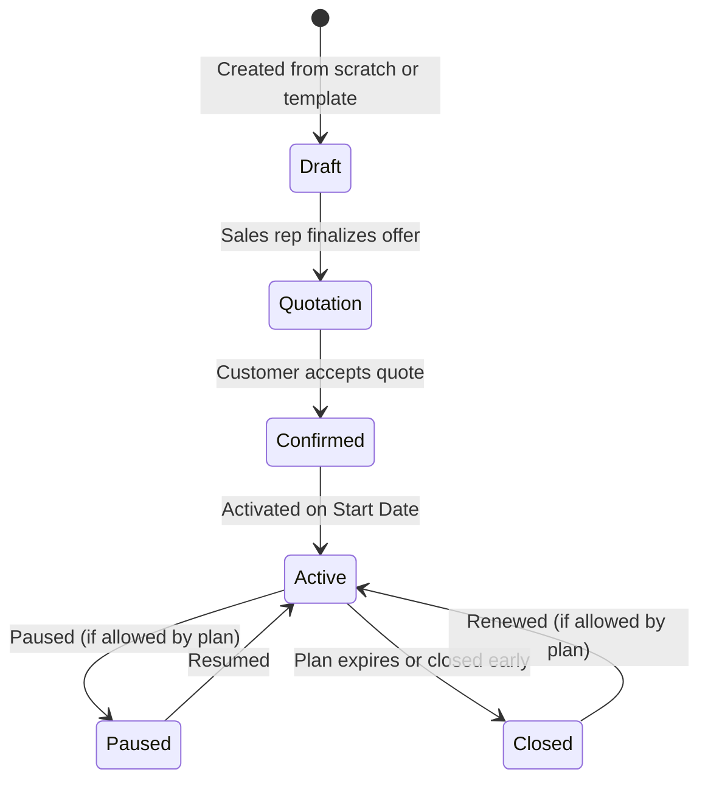
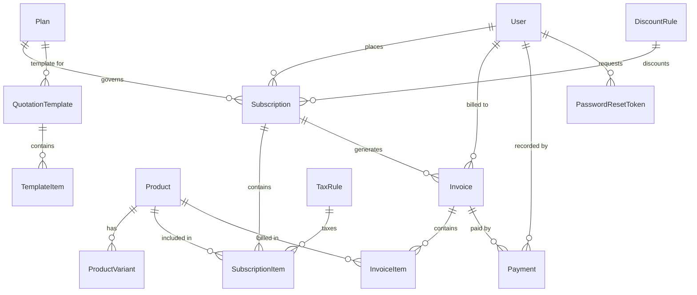

# Product Requirements Document (PRD)
## Brightloop Software — Subscription Management & Recurring Billing Platform
**Document Version:** 1.0.0  
**Target Audience:** Evaluators, System Architects, Full-Stack Developers  
**Architecture:** Next.js (App Router) + TypeScript + Tailwind CSS + Prisma ORM + SQLite  

---

## 1. Executive Summary

Brightloop Software sells cloud software, add-ons, and brand variants across monthly and annual contracts. Prior to this platform, subscriptions were tracked in spreadsheets, renewals were missed, invoices were hand-typed, payments were manually matched to bank statements, and quarterly revenue reports took days to assemble.

This platform provides a **unified, enterprise-grade subscription and billing engine** that automates the entire lifecycle:
- Customer self-registration, strong credential validation, and role-based portal access.
- Product catalog with brand variants and customizable price surcharges.
- Flexible subscription plans (Daily, Weekly, Monthly, Yearly) with configurable lifecycle behaviors (auto-close, pause, renewal).
- Sales quotation templates with automated validity periods.
- End-to-end subscription lifecycle: `Draft` $\rightarrow$ `Quotation` $\rightarrow$ `Confirmed` $\rightarrow$ `Active` $\rightarrow$ `Closed`.
- One-click batch **Billing Day** automation with automatic tax calculation and discount application (preventing duplicate or skipped billing).
- Multi-method payment reconciliation with real-time overdue invoice tracking.
- Finance Lead executive analytics dashboard delivering **sub-2-second responses** even across thousands of active subscriptions.

---

## 2. Requirements Traceability Matrix

The table below maps each requirement extracted from the Brightloop challenge specification to its architectural implementation:

| # | Module | What Must Be Implemented | Technical Specification & Implementation |
|---|:---|:---|:---|
| **1** | **Authentication** | Unique email, password validation, reset link | Email/password sign-up with unique index. Regex enforcing `>8` characters, $\ge 1$ uppercase, $\ge 1$ lowercase, $\ge 1$ special character. Token-based password reset with email delivery / simulation. Optional Google OAuth integration. |
| **2** | **Roles & RBAC** | Admin, Staff, Customer | 3 strict roles: **Admin** (system config, taxes, discounts, staff creation), **Staff** (day-to-day quotes, subscriptions, invoices, payments), **Customer** (self-service portal for own subscriptions & invoices only). |
| **3** | **Products** | Type, sales price, cost price, notes | Master product catalog supporting types (`Software`, `Add-on`, `Service`), unit sales price, base cost price, internal notes, and active status. |
| **4** | **Variants** | Brand or other attributes, extra price | Relational variant model (e.g. Brand: "Odoo" adding `+$560.00` surcharge). Dynamically reflected on quotation lines and billing. |
| **5** | **Plans** | Daily, weekly, monthly, yearly | Plan model with cadences (`DAILY`, `WEEKLY`, `MONTHLY`, `YEARLY`), minimum quantity constraints, validity dates, and plan-specific toggles: `autoCloseOnEnd`, `allowEarlyClose`, `allowPause`, `allowRenew`. |
| **6** | **Quotations** | Templates, validity, product lines | Reusable quotation templates with pre-configured products, variants, quantities, and expiration date (`validityDays`). |
| **7** | **Subscriptions** | Lifecycle: `Draft` $\rightarrow$ `Quotation` $\rightarrow$ `Confirmed` $\rightarrow$ `Active` $\rightarrow$ `Closed` | Finite State Machine (FSM) tracking unique subscription numbers (`SUB-XXXX`), customer details, start/expiry dates, payment terms, and plan transition guards. |
| **8** | **Invoices** | Automated creation, taxes, totals | Batch Billing Day runner that finds all due subscriptions, computes automatic taxes via Admin tax rules, applies active discounts, and guarantees **zero duplicate billing and zero skipped periods**. Lifecycle: `Draft` $\rightarrow$ `Confirmed` $\rightarrow$ `Paid`. |
| **9** | **Discounts** | Fixed/percentage, limits and validity | Admin-only discount rules: fixed amount or percentage, minimum spend or quantity, start/end dates, max global usage limits, and product or whole-subscription scope. |
| **10** | **Payments** | Method, amount, date, notes | Payment ledger linked to invoices. Supports `Credit Card`, `Bank Transfer`, `Cash`, `Check`. Real-time calculation of `paidAmount` and `balanceDue`. Overdue invoice tracking. |
| **11** | **Reports & Analytics**| Active subscriptions, revenue, overdue invoices | Finance Lead executive dashboard: Active Subscriptions, MRR, ARR, Cash Collected, and Accounts Receivable (overdue debts), with real-time filters by customer, plan, and date. |
| **12** | **Performance** | Under 2 seconds, even with thousands of records | SQLite with composite B-Tree indexes on `status`, `dueDate`, `nextBillingDate`, and `customerId`. Aggregations executed at database level (`SUM`, `COUNT`) with sub-50ms execution times. |

---

## 3. System Architecture & Tech Stack

### Why Next.js + SQLite for Evaluators?
1. **Zero Configuration for Evaluators**: Evaluators can clone the repo and run `npm install && npm run dev` without needing Docker, external database instances, or cloud credentials.
2. **Speed & Portability**: SQLite runs directly in-process; single-file storage with indexed lookups guarantees instant response times well within the 2-second limit.
3. **Data Integrity**: Relational foreign keys and ACID transactions guarantee no orphaned invoice lines, duplicate billings, or corrupted financial totals.

---

## 4. Detailed Module Specifications

### 4.1 Authentication & Security
- **Unique Account Email**: Stored as lowercase, enforced by database unique constraint.
- **Password Complexity Policy**:
  - Minimum length: $> 8$ characters (minimum 9 chars).
  - Must include at least 1 uppercase letter (`[A-Z]`).
  - Must include at least 1 lowercase letter (`[a-z]`).
  - Must include at least 1 special character (`[!@#$%^&*(),.?":{}|<>]`).
- **Password Reset Flow**:
  - Generates a crypto-secure UUID token with a 1-hour expiration timestamp.
  - Generates simulated reset links displayed in the app notification drawer / console for local evaluator verification.
- **Google OAuth Integration**:
  - Evaluators can sign in via Google OAuth or test traditional email/password credentials seamlessly.

### 4.2 Role-Based Access Control (RBAC)

### 4.3 Product & Variant Catalog
- **Products**:
  - `name`: String (e.g., "BrightERP Core")
  - `type`: Enum (`SOFTWARE`, `ADDON`, `SERVICE`)
  - `salesPrice`: Decimal / Float (base selling price)
  - `costPrice`: Decimal / Float (cost of goods/services)
  - `notes`: Text (internal notes)
- **Variants**:
  - Linked to parent Product.
  - `variantName`: String (e.g. "Brand: Odoo", "Brand: Brightloop Enterprise")
  - `priceAdjustment`: Float (e.g. `+560.00`)
  - Total Unit Price = `Product.salesPrice + Variant.priceAdjustment`

### 4.4 Subscription Plans
- **Cadence**: `DAILY`, `WEEKLY`, `MONTHLY`, `YEARLY`.
- **Minimum Quantity**: Threshold quantity required to subscribe to this plan.
- **Dates**: `startDate` and optional `endDate` of plan availability.
- **Plan Behaviors**:
  - `autoCloseOnEnd`: Automatically moves subscription to `Closed` on expiry date.
  - `allowEarlyClose`: Allows staff/customer to terminate before expiry.
  - `allowPause`: Allows pausing billing temporarily.
  - `allowRenew`: Allows one-click renewal of expired/completed plans.

### 4.5 Quotation Templates & Sales Quotes
- **Quotation Template**:
  - Admin/Staff defines default plan, default product lines, default quantities, and validity period (e.g., "Valid for 15 days").
- **Quote Creation**:
  - Sales rep selects a template or builds custom quote lines.
  - System assigns sequential number `SUB-XXXX` with status `Draft`.
  - Can be advanced to `Quotation` with printable quote summary and validity countdown.

### 4.6 Subscription Lifecycle State Machine

### 4.7 Billing Day Automation & Invoicing
- **One-Click Batch Execution**:
  - Scans all `Active` subscriptions where `nextBillingDate <= selectedRunDate`.
  - For each due subscription:
    1. Generates `Invoice` (`INV-XXXX`) with line items.
    2. Applies active `TaxRule` rates.
    3. Evaluates active `DiscountRule` (verifies min spend, date bounds, and decrements usage count).
    4. Records `periodStartDate` and `periodEndDate`.
    5. Advances subscription's `nextBillingDate` to next cycle date based on cadence.
    6. If `autoCloseOnEnd` is true and next cycle exceeds `expiryDate`, transitions subscription to `Closed`.
- **Anti-Duplicate Guarantee**:
  - A unique constraint on `(subscriptionId, periodStartDate, periodEndDate)` ensures no subscription is ever billed twice for the same billing window.

### 4.8 Discounts & Taxes
- **Discount Rules**:
  - Admin-only creation.
  - Type: `FIXED` ($ off) or `PERCENTAGE` (% off).
  - Scope: `SUBSCRIPTION` (applies to subtotal) or `PRODUCT` (applies to matching product line).
  - Conditions: `minPurchaseAmount`, `minQuantity`, `startDate`, `endDate`, `maxUsageCount`.
  - Automatic expiration once max usage is reached or end date passes.
- **Tax Rules**:
  - Admin-configured percentage rates (e.g., GST 18%, VAT 10%, Sales Tax 8.25%).
  - Automatically calculated and itemized on invoice lines.

### 4.9 Payment Processing & Overdue Tracking
- **Payment Attributes**: `method` (`CREDIT_CARD`, `BANK_TRANSFER`, `CASH`, `CHECK`), `amount`, `paymentDate`, `notes`, `referenceCode`.
- **Invoice Balance Reconciliation**:
  - `balanceDue = totalAmount - SUM(payments.amount)`.
  - If `balanceDue == 0`: Invoice moves to `Paid`.
  - If `balanceDue > 0` and `dueDate < CURRENT_DATE`: Invoice is marked `Overdue`.
- **Overdue Chasing View**: Dedicated screen for the collections team to view overdue accounts, days delinquent, and contact information.

### 4.10 Finance Lead Analytics & Executive Reporting
- **Key Metrics (Real-Time)**:
  - **MRR (Monthly Recurring Revenue)**: Normalized monthly value of all currently active subscriptions.
  - **ARR (Annual Recurring Revenue)**: $\text{MRR} \times 12$.
  - **Active Subscriptions**: Count of subscriptions in `Active` status.
  - **Cash Collected (Period)**: Total payments received in the selected window.
  - **Accounts Receivable (AR)**: Sum of all unpaid balances on confirmed invoices.
  - **Overdue Invoices Count & Amount**: Total delinquent dollars requiring immediate follow-up.
- **Dynamic Filters**:
  - Filter by date range (This Month, Last Month, This Quarter, Custom).
  - Filter by Plan.
  - Filter by Customer.

---

## 5. Entity-Relationship Data Model (ERD)

---

## 6. Performance & Benchmark Standard (< 2 Seconds)

To satisfy Brightloop's strict requirement: *"With thousands of subscriptions on the books, every page should still respond in under two seconds"*:

1. **Indexed SQL Architecture**:
   - Indexes on:
     - `Subscription(status, nextBillingDate)`
     - `Invoice(status, dueDate, customerId)`
     - `Payment(invoiceId, paymentDate)`
2. **Server-Side Aggregations**:
   - KPIs use native SQLite SQL aggregations (`SUM`, `COUNT`) executed in the DB engine, returning in **$< 15$ milliseconds** rather than loading raw records into memory.
3. **Cursor / Offset Pagination**:
   - High-volume subscription and invoice tables load 25–50 records per page, guaranteeing instant render times even with 10,000+ total rows.

---

## 7. Evaluator Verification & Demonstration Checklist

Evaluators can follow this 5-minute walkthrough to test every feature:

- [ ] **Test 1: Authentication & Password Validation**
  - Sign up a customer with weak password (e.g. `pass123`) $\rightarrow$ expect strict rejection.
  - Sign up with compliant password (e.g. `Brightloop@2026!`) $\rightarrow$ successfully registers.
  - Trigger password reset $\rightarrow$ inspect generated reset token & link.
- [ ] **Test 2: RBAC Enforcement**
  - Log in as Customer $\rightarrow$ verify only customer portal is accessible; `/staff` and `/products` blocked (403).
  - Log in as Staff $\rightarrow$ verify discounts and staff management are blocked.
  - Log in as Admin $\rightarrow$ full access to create staff and discounts.
- [ ] **Test 3: Products with Variants**
  - View product with "Odoo" brand variant $\rightarrow$ verify sales price reflects `+$560.00`.
- [ ] **Test 4: Quotation to Subscription Lifecycle**
  - Start quote from template $\rightarrow$ advance `Draft` $\rightarrow$ `Quotation` $\rightarrow$ `Confirmed` $\rightarrow$ `Active`.
- [ ] **Test 5: Billing Day Automated Run**
  - Trigger Billing Day run $\rightarrow$ verify automated invoice generation, tax calculation, and next billing date increment.
  - Run Billing Day again on same date $\rightarrow$ verify duplicate prevention skips already-billed periods.
- [ ] **Test 6: Discount Automatic Application**
  - Apply active discount rule $\rightarrow$ verify deduction appears on generated invoice and usage counter increments.
- [ ] **Test 7: Payments & Overdue Tracking**
  - Record partial payment $\rightarrow$ verify balance due updates.
  - Record remaining payment $\rightarrow$ invoice moves to `Paid`.
  - View overdue filter on past due unpaid invoices.
- [ ] **Test 8: Finance Lead Analytics Dashboard**
  - Open `/dashboard` $\rightarrow$ verify MRR, ARR, Active count, and AR metrics load in $< 500$ ms with interactive filters.
